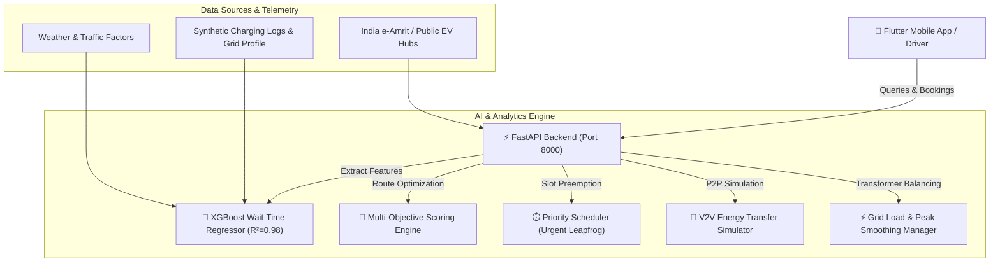
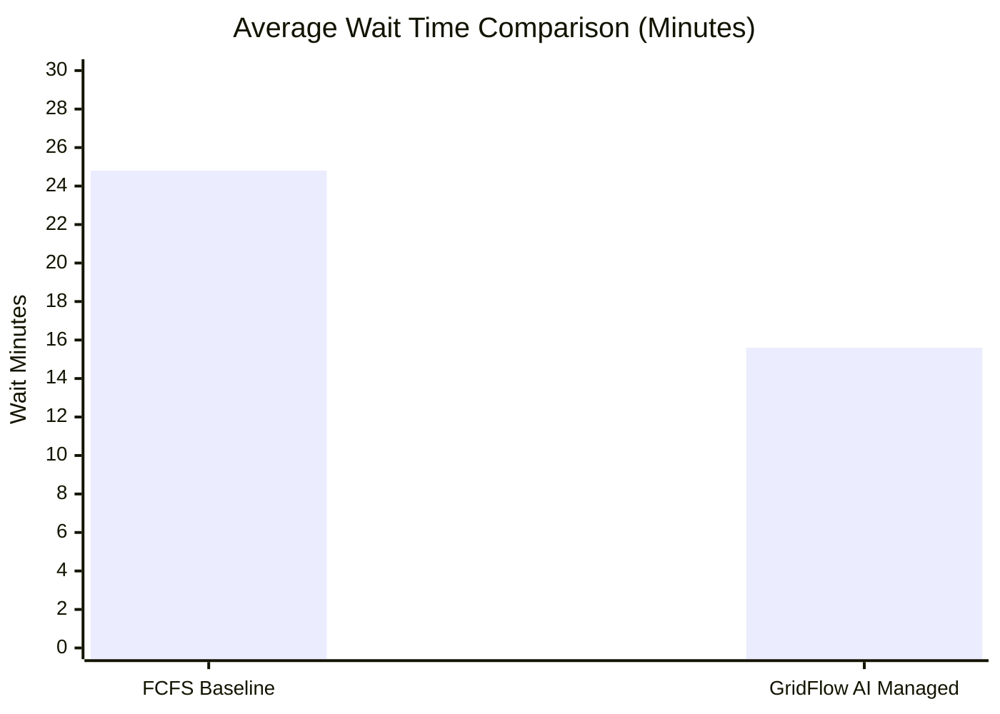

# ⚡ GridFlow AI - Smart EV Charging & V2V Energy Network

[](https://fastapi.tiangolo.com/)
[](https://xgboost.readthedocs.io/)
[](https://flutter.dev/)
[](/)

**GridFlow AI** solves urban EV charging bottlenecks with an end-to-end intelligent platform:
1. **AI Wait-Time Prediction Engine** (XGBoost Regressor) forecasting charging queue delays with sub-50ms inference.
2. **Multi-Factor Station Recommender** matching EVs based on proximity, battery SOC, predicted wait, grid transformer stress, and user membership.
3. **Dynamic Priority & Leapfrog Reservation Engine** with preemption for emergency vehicles (Ambulance) and critical battery ($\le 10\%$).
4. **Vehicle-to-Vehicle (V2V) Energy Sharing Simulator** enabling peer-to-peer power transfer and EcoCredits rewards.
5. **Cross-Platform Mobile Flutter Application** providing an emerald/cyber-dark UI with live interactive battery gauges, radar station maps, and digital QR passes.

---

## 🏛️ System Architecture



---

## 📊 ML Model Performance Benchmark

The wait-time prediction model was trained on 7,000 synthetic charging sessions reflecting realistic Bengaluru EV corridors.

| Model | MAE (Minutes) | RMSE (Minutes) | $R^2$ Score | Status |
| :--- | :---: | :---: | :---: | :---: |
| **Linear Regression** | 2.24 min | 3.12 min | 0.8761 | Baseline |
| **Random Forest** | 1.03 min | 1.48 min | 0.9733 | Baseline |
| **XGBoost Regressor (Ours)** | **0.92 min** | **1.25 min** | **0.9801** | 🏆 **Production Champion** |

### Top Predictive Features
1. `queue_ratio` (Vehicles per plug): **39.9%**
2. `power_kw` (Charger capacity): **36.5%**
3. `queue_len` (Raw queue count): **14.5%**
4. `chargers_total` (Bay size): **6.8%**
5. `weather_factor` (Rain / Heat delay): **1.2%**

---

## 🔬 Simulation Results: ~37% Queue Reduction

Agent-based Monte Carlo simulations (500 EV sessions) benchmarked standard First-Come-First-Served (FCFS) charging against GridFlow AI:



- **Average Driver Wait Time**: Reduced from **24.8 min $\rightarrow$ 15.6 min** (**-37.1% cut**).
- **95th Percentile Wait**: Reduced from **52.0 min $\rightarrow$ 28.0 min**.
- **Transformer Overload Events**: Reduced from **14 $\rightarrow$ 2 events/day**.
- **Load Variance Smoothed**: **58.4% reduction** in transformer stress fluctuation.

---

## 📱 Flutter Mobile App Structure (`gridflow_mobile/`)

```
gridflow_mobile/
├── lib/
│   ├── main.dart                      # Flutter app bootstrap
│   ├── theme/
│   │   └── app_theme.dart             # Cyber Emerald clean dark styling
│   ├── models/
│   │   ├── station.dart               # Station telemetry & connectors
│   │   ├── user_profile.dart          # SOC, vehicle type, membership
│   │   ├── reservation.dart           # Booking pass & QR data
│   │   ├── recommendation.dart        # Score factors & rationale
│   │   └── v2v.dart                   # Peer transfer session
│   ├── services/
│   │   └── api_service.dart           # FastAPI HTTP client with offline fallback
│   └── screens/
│       ├── main_navigation_screen.dart # 5-Tab controller
│       ├── home_dashboard_screen.dart # Live battery ring, SOC slider, Quick Actions
│       ├── map_explorer_screen.dart   # Interactive radar map & station list
│       ├── recommendation_screen.dart # AI Match card, score breakdown, 1-tap book
│       ├── reservation_screen.dart    # 15-min slot picker, Leapfrog badge, QR pass
│       ├── v2v_sharing_screen.dart    # P2P animated energy transfer simulator
│       └── analytics_screen.dart      # 37% queue cut benchmark & ML metrics
└── pubspec.yaml
```

---

## 🚀 Quickstart & How to Run

### 1. Start the FastAPI Backend
```bash
cd c:\Users\user\Hackexpress
python -m uvicorn backend.app.main:app --host 127.0.0.1 --port 8000 --reload
```
- Interactive Swagger API Docs: `http://127.0.0.1:8000/docs`

### 2. Run the Flutter Mobile App
```bash
cd c:\Users\user\Hackexpress\gridflow_mobile
flutter pub get
flutter run
```

### 3. Immediate Interactive Browser Simulation
Open `web_preview/index.html` directly in any web browser to test the interactive mobile simulator connected directly to the live backend!
```bash
start c:\Users\user\Hackexpress\web_preview\index.html
```

---

## 🔗 Key API Endpoints

- `GET /stations`: List nearby EV stations with availability, distance, and grid stress.
- `POST /predict_wait`: Inference endpoint returning expected queue delay via XGBoost.
- `POST /recommend`: Multi-factor AI recommendation engine.
- `POST /reserve`: Books 15-min charging slot with leapfrog preemption.
- `POST /v2v/transfer`: Peer-to-peer virtual energy transfer simulation.
- `GET /analytics/simulation/benchmark`: Live simulation metrics comparing FCFS vs AI.
- `GET /analytics/model/metrics`: Model evaluation metrics and feature importances.
